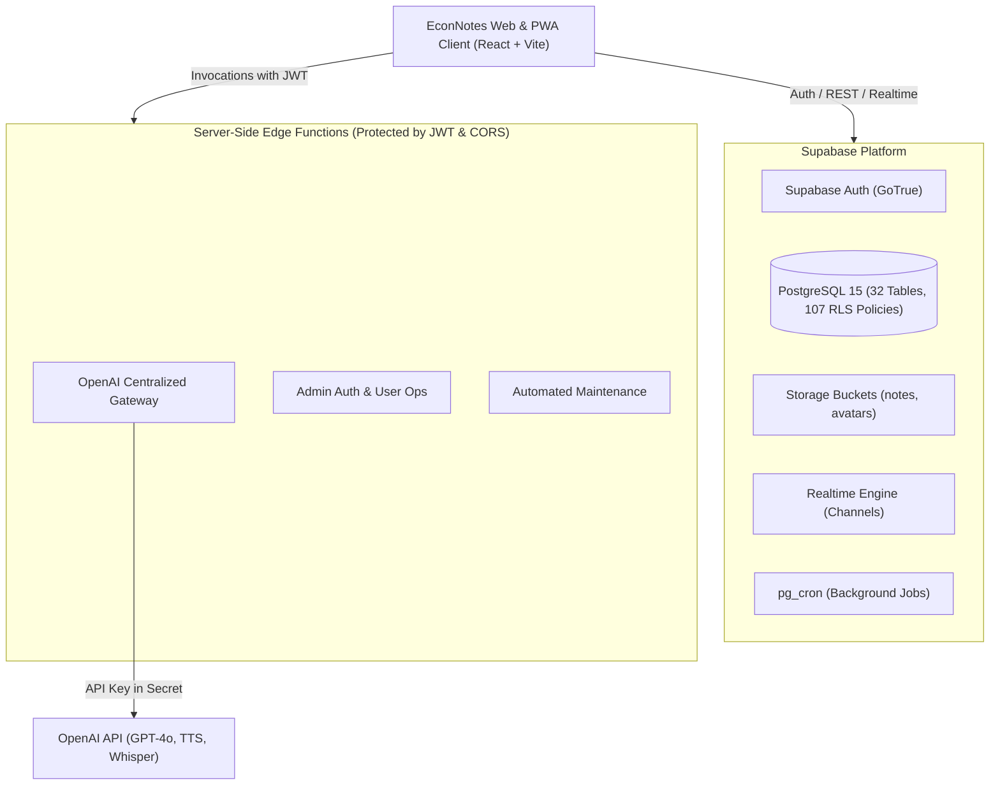
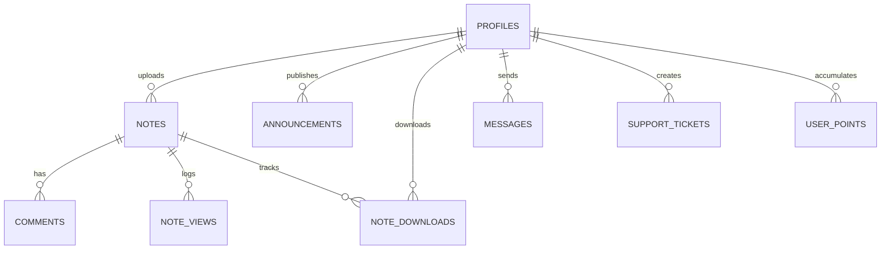

# EconNotes 2.0 – Master Architecture Document

**Document Version:** 2.0.0  
**Generated:** 2026-11-05  
**Platform Version:** `v2.20.102`  
**Target Environment:** Independent Supabase Project + Vercel / Independent Frontend Hosting + OpenAI AI Gateway  

---

## 1. System Overview & Architectural Topology

EconNotes is a comprehensive academic platform built with React 18, TypeScript, Tailwind CSS, Vite, and Supabase (PostgreSQL 15+, Auth, Storage, Edge Functions, Realtime).

---

## 2. Frontend Architecture & Routing Matrix

The client utilizes React Router DOM v6 with lazy loading, error boundaries, route loaders, and splash screens.

| Route | Component | Page Guard / Access Level | Core Responsibilities |
|---|---|---|---|
| `/` | `Index` | Public | Landing hero, features overview, dynamic statistics, live announcements banner |
| `/login` | `Login` | Public (Unauthenticated) | Email/Password login, Google OAuth, Apple OAuth, Math Captcha, 30s timeout safety |
| `/register` | `Register` | Public (Unauthenticated) | Multi-step student registration, university, department, grade level selection |
| `/forgot-password`| `ForgotPassword` | Public | Password reset request via email link |
| `/reset-password` | `ResetPassword` | Public / Callback | Secure password update form |
| `/welcome` | `Welcome` | Authenticated | First-time user onboarding tour with versioned local-storage acknowledgement |
| `/notes` | `Notes` | Authenticated (`PageGuard`) | Notes catalog, fuzzy search, semester/course filters, PDF watermark preview, quota check |
| `/announcements` | `Announcements` | Authenticated (`PageGuard`) | Platform announcements, rich markdown rendering, attachment downloads |
| `/profile` | `Profile` | Authenticated (`PageGuard`) | User profile, avatar management, uploaded notes tracking, download quota display |
| `/messages` | `Messages` | Authenticated (`PageGuard`) | Real-time 1-on-1 messaging, friend requests, user blocking, report abuse |
| `/assistant` | `AcademicAssistant` | Authenticated (`PageGuard`) | Academic AI tutor, file and document upload context, course study Q&A |
| `/study` | `Study` | Authenticated (`PageGuard`) | Study Studio: interactive video generator, flashcards, quizzes, audio narration |
| `/kpss` | `Kpss` | Authenticated (`PageGuard`) | KPSS preparation hub: topic likelihood engine, ÖSYM quiz solver, flashcard decks |
| `/live-class` | `LiveClass` | Authenticated / Admin Only | Real-time live lecture audio capture, speech transcription, structured summary |
| `/points` | `Points` | Authenticated (`PageGuard`) | Student gamification hub, daily login reward, weekly missions, leaderboard |
| `/support` | `Support` | Authenticated | Support ticketing system, real-time ticket messaging, status tracking |
| `/admin` | `AdminPanel` | Admin Only (`is_admin`) | Full platform administration, users, moderation, quotas, temporary passwords, config |
| `/about` | `About` | Authenticated (`PageGuard`) | About platform, mission, version badge (`APP_VERSION_LABEL`) |
| `/install` | `Install` | Public | Progressive Web App instructions and Windows desktop executable download |

---

## 3. Database Architecture (32 Tables, 22 Functions, 17 Triggers)

### Core Schema Tables

1. **Authentication & Identity Mapping:**
   - `public.profiles`: Primary profile table keyed to `user_id (UUID) -> auth.users(id)`. Contains `email`, `display_name`, `university`, `department`, `grade`, `role`, `download_quota`, `manual_download_quota`, `avatar_url`, `created_at`, `last_login`.
   - `public.user_roles`: Role separation table (`admin`, `moderator`, `user`).
   - `public.member_directory`: Public directory view with privacy masks.

2. **Academic Content & Storage:**
   - `public.notes`: Main academic notes repository (33 records).
     - Columns: `id`, `user_id`, `title`, `description`, `grade`, `department`, `course`, `semester`, `file_url`, `file_name`, `file_type`, `uploader_name`, `editor_name`, `university`, `status`, `view_count`, `download_count`, `created_at`, `updated_at`.
   - `public.note_downloads`: Tracks downloads per user and enforces quotas.
   - `public.note_views`: Anonymous and authenticated viewing analytics.
   - `public.note_password_unlocks`: Authorized note unlocking sessions.
   - `public.comments`: Peer discussions and comments on notes.

3. **Content & Editorial:**
   - `public.announcements`: Official site news (16 records).
   - `public.announcement_views`: Read-state tracking.
   - `public.banners`: Global header announcements (4 records).
   - `public.site_config`: Global site settings, logo URL, branding, active theme (1 record).

4. **Study Studio & Academic AI:**
   - `public.study_materials`: Persisted flashcards, quizzes, summaries, and video scenes.
   - `public.study_progress`: User mastery, flashcard flip states, quiz scores.
   - `public.study_reports`: Analytical reports generated for study sessions.

5. **KPSS Center:**
   - `public.kpss_materials`: Saved KPSS exam decks and summaries.
   - `public.kpss_goals`: User goal setting and daily target questions.
   - `public.kpss_presets`: Standard curriculum presets.
   - `public.kpss_reviews`: Spaced repetition review schedules.
   - `public.kpss_attempts`: Question attempt history with detailed question choices.

6. **Social & Communication:**
   - `public.messages`: End-to-end encrypted or protected student direct messages.
   - `public.friend_requests`: Student connection requests.
   - `public.user_blocks`: User-initiated blocking for safety.
   - `public.message_reports`: Abuse and content reporting.

7. **Gamification & Quotas:**
   - `public.user_points`: Aggregated points and daily streak count.
   - `public.point_events`: Immutable ledger of point rewards (`daily_login`, `mission_*`, `note_upload`).
   - `public.penalties`: Temporary or permanent moderation suspensions.

8. **Support & Operations:**
   - `public.support_tickets`: Support requests with priority and status.
   - `public.support_ticket_messages`: Back-and-forth communication on tickets.
   - `public.activity_logs`: Administrative audit trail.
   - `public.system_settings`: Platform maintenance toggles (`maintenance_mode`).
   - `public.public_system_status`: Publicly readable health and maintenance state.

---

## 4. Storage Architecture

* **Bucket 1: `notes`**
  - **Public:** `true` (Objects accessible via signed or public CDN URLs).
  - **Access Control:** Authenticated upload; public read; author or admin delete.
  - **Structure:** `notes/{user_id}/{filename}` and top-level numbered archive files.
  - **Inventory:** 33 active files (103.89 MB) ready for upload.

* **Bucket 2: `avatars`**
  - **Public:** `true`.
  - **Access Control:** User can only upload/delete within `avatars/{user_id}/*`.

---

## 5. Security & Authorization Framework (RLS)

* **Row Level Security (RLS):** Enabled on 100% of public tables (107 policies).
* **Role Verification:** `public.is_admin(_user_id uuid)` is defined as `SECURITY DEFINER` with fixed `search_path = public` to prevent privilege escalation.
* **Quota Enforcement:** `get_download_quota(_user_id)` and `admin_set_download_quota(_user_id, _quota)` enforce strict limits directly inside PostgreSQL.
* **CORS & Origin Security:** All Edge Functions enforce `isTrustedOrigin()` checking against `econnotes.online`, `localhost`, and trusted deployment domains.

---

## 6. Realtime Subscriptions

Active realtime channels are managed for:
1. `ContentNotificationListener`: Notifies users of newly approved notes and urgent announcements.
2. `SupportNotificationListener`: Notifies students when admins respond to support tickets.
3. `UserPenaltyMonitor`: Immediately notifies or logs out penalized users.
4. `useSystemStatus`: Detects platform maintenance mode changes in real-time.
5. `Messages`: Live direct message delivery without polling.
